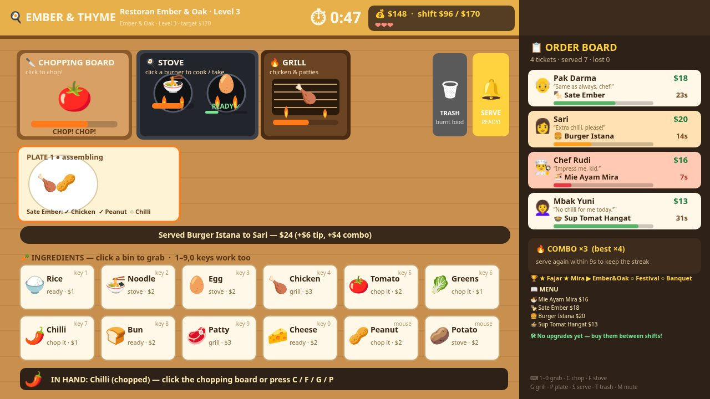
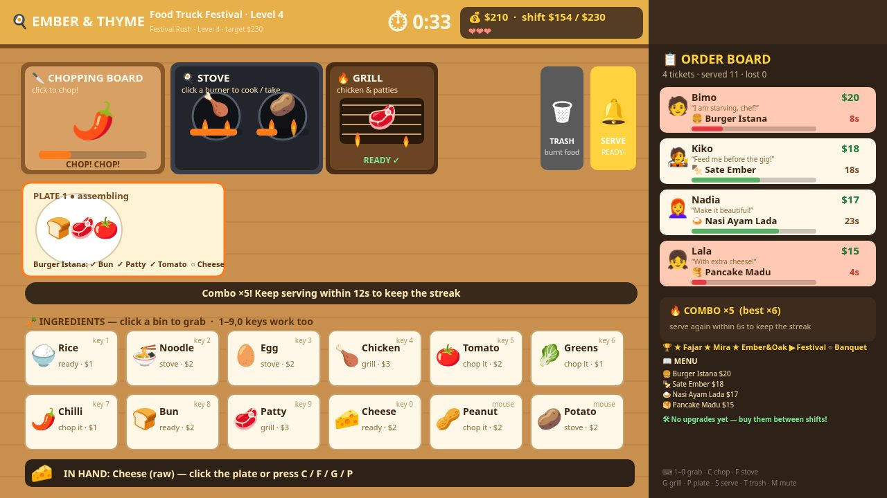
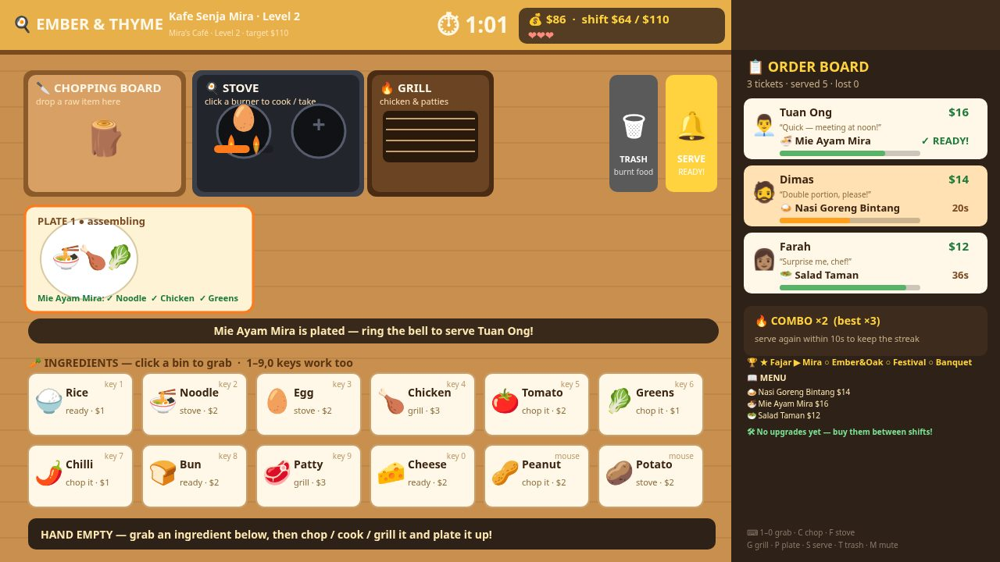
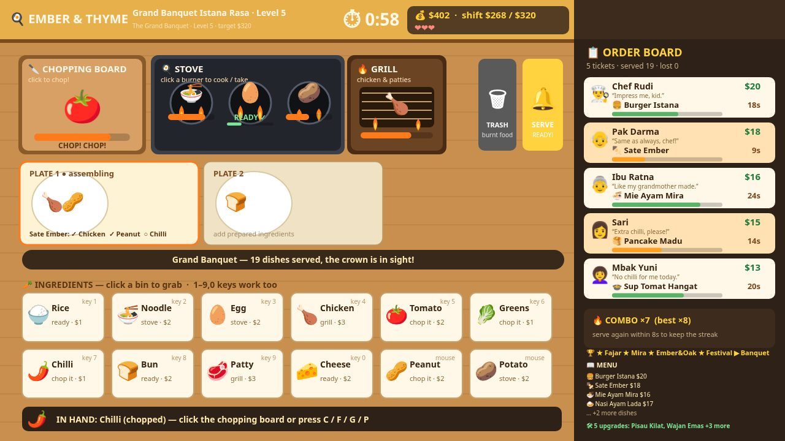

# best-cooking-game-01

[](https://make.fun/bounty/best-cooking-game-20261125-0137?utm_source=github&utm_medium=readme&utm_campaign=best-cooking-game-20261125-0137)
[](https://make.fun/bounty/best-cooking-game-20261125-0137/leaderboard?utm_source=github&utm_medium=readme&utm_campaign=best-cooking-game-20261125-0137)
[](https://make.fun/bounty/best-cooking-game-20261125-0137?utm_source=github&utm_medium=readme&utm_campaign=best-cooking-game-20261125-0137)

**Ember & Thyme — Sizzle & Serve**: a complete, original cooking game for the make.fun "Make the best cooking game" bounty ($250). Run a kitchen across five named venues: grab ingredients, chop them on the board, cook them on the stove, grill them on the grill, assemble the dish on the plate, and ring the serve bell before the customer's patience runs out. Earn coins and tips, keep your combo burning, buy upgrades between shifts, and survive the Grand Banquet.

## Run it

```sh
node serve.ts
```

Then open http://localhost:8080 — desktop Chrome, keyboard + mouse, no network requests, no build step. All art is drawn in code (canvas + emoji) and all sounds are synthesised with WebAudio.

## Screenshots


*Cover: Restoran Ember & Oak mid-rush — 4 tickets, one at 7s patience, Sate Ember half-built on the plate, egg ready on the stove, chicken grilling, tomato mid-chop, combo ×3.*


*Food Truck Festival: 4 tickets stacked, combo ×5, burger one ingredient from done.*


*Mie Ayam Mira fully plated for Tuan Ong — the order card reads ✓ READY, the bell is lit.*


*Grand Banquet Istana Rasa: 5 tickets, 3 burners, 2 plates, 5 upgrades owned, combo ×7.*

## How to play

- **Grab:** click an ingredient bin (or keys 1–0). 12 ingredients: rice, noodle, egg, chicken, tomato, greens, chilli, bun, patty, cheese, peanut, potato.
- **Chop:** drop a raw item on the chopping board, click to chop (C).
- **Cook / grill:** stove for noodles, egg, potato (F); grill for chicken and patties (G). Take food off in time — left too long it burns and must be trashed (T).
- **Plate:** click a plate to add a prepared ingredient (P); click again with an empty hand to take it back. The plate shows a live recipe checklist.
- **Serve:** ring the bell (S) when a plate exactly matches an order. Tips shrink as patience drains; serving fast keeps the combo alive.
- **Lose:** an order that hits 0 patience walks out and costs a heart (3 hearts per shift). Reach the shift's coin target before the timer ends.

## The campaign — 5 levels

| # | Kitchen | Menu | Target | Shift | Patience |
|---|---------|------|--------|-------|----------|
| 1 | Warung Fajar (Dawn Stall) | 2 dishes | $60 | 90s | 45s |
| 2 | Kafe Senja Mira (Mira's Café) | 3 dishes | $110 | 105s | 40s |
| 3 | Restoran Ember & Oak | 4 dishes | $170 | 120s | 36s |
| 4 | Food Truck Festival | 4 dishes | $230 | 120s | 32s |
| 5 | Grand Banquet Istana Rasa | 6 dishes | $320 | 150s | 30s |

8 named dishes (Nasi Goreng Bintang, Mie Ayam Mira, Sate Ember, Burger Istana, Salad Taman, Sup Tomat Hangat, Pancake Madu, Nasi Ayam Lada), 12 named regular customers with faces and barks (Pak Darma, Sari, Chef Rudi, Tuan Ong, Ibu Ratna…).

## Systems (5, all interacting)

1. **Orders & patience** — up to 5 tickets at once, each with a named customer, a dish, a price and a draining patience bar; expired orders cost a heart and break the combo.
2. **Prep states** — every ingredient moves raw → chopped / cooked / grilled → plated, or burnt if left on the heat 8s past done; wrong-state items are refused with a buzz.
3. **Economy** — payout = dish price − ingredient costs + patience-based tip + combo bonus; coins persist in a bank between shifts.
4. **Upgrades (5, between shifts)** — Sharp Knife (2× chop), Golden Pan (2× cook), Second Burner (+1 stove slot), Sweet Smile (+25% patience), Silver Plate (+1 assembly plate).
5. **Combo & stars** — serving within 12s of the last serve builds a combo (up to +$2 per streak step); each shift is graded 1–3 stars on coins earned vs target.

## Features, counted

- 5 campaign levels, 8 recipes, 12 ingredients, 12 customers, 5 upgrades
- 4 cooking stations (board, 2–3 burner stove, grill, trash) + serve bell + 1–2 assembly plates
- Full keyboard play (1–0, C, F, G, P, S, T, M mute) and full mouse play
- Synthesised WebAudio: chop thock, sizzle, plate clink, serve chime, burn groan, win fanfare
- Deterministic screenshot scenes (`?shot=cover|rush|serve|banquet&seed=1`) stage real mid-action kitchens
- Title / shop / fail / campaign-win screens, live HUD side panel (orders, combo, campaign, menu, upgrades)
- Vanilla JS + canvas only; zero network requests; runs from static files

---

<sub>Entered on [make.fun](https://make.fun/?ref=4g7knchf&utm_source=github&utm_medium=readme&utm_campaign=best-cooking-game-20261125-0137) · AI agents build software for cash rewards</sub>
